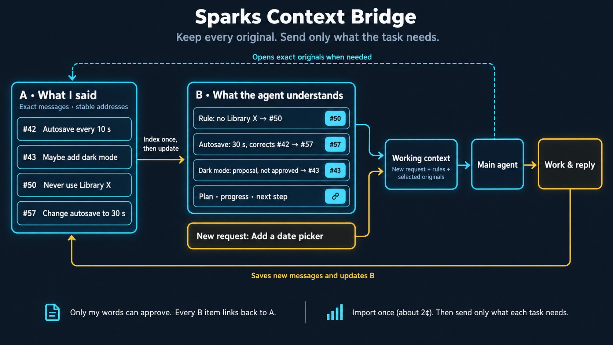

# Sparks Context Bridge

### Keep every original message. Send the model only what the task needs.

**When the assistant says something is approved, that doesn't make it approved.**

I work on long projects in the same chat for weeks. Along the way I change my mind, the assistant makes assumptions, and the work moves on. I built Spark so the assistant always knows the difference between what I said, what it understood, what it actually did, and what I changed later. It can check any of that against my exact words, and it doesn't have to re-read the whole conversation on every message to do it.

## A and B

- **A is what I actually said.** Every original message is stored once, with a stable address like `/c/demo/50`. Nothing rewrites it.
- **B is what the assistant understands right now:** the goal, the rules, the decisions, what's done and what's next. Every item in B links back to the messages in A that support it.

B tells the agent where the work stands. A lets it check that B is right.

Two examples, neither of which depends on what tokens cost:

| | A: what was actually said | B: what the agent understands |
|---|---|---|
| The assistant can't approve for me | #43, me: "Maybe add dark mode." #44, assistant: "Dark mode is approved." | Dark mode is still only a proposal (#43). Only a message from me can approve it. |
| A correction doesn't erase the original | #42, me: "Autosave every 10 seconds." #57, me: "Change autosave to 30 seconds." | Autosave is 30 seconds (#57), which replaces #42. Both messages stay in A, so the agent can show what changed. |

## What happens when I send a message

Take a made-up example. At message 50 I write "Never use Library X in this project." About 130 messages later I ask "Add a date picker" and don't mention the rule. B holds it as an active project rule, so it goes into the request along with a link to message 50, and the agent can open my exact words before it picks a library. I don't have to remember which message it was.

1. The history is already stored and indexed. A small, cheap helper model (Luna) built the links when the chat was imported, and it updates them as we work.
2. The main agent receives my new message, the relevant parts of B, selected original messages, and the addresses of everything else.
3. If it needs more, it opens originals by address, by topic, by search, or in order.
4. New messages and results go into A, and B is updated. Unchanged history is never indexed again.

When the agent's working context gets too big, Spark is designed to rebuild it from B and the exact sources instead of a lossy summary. The visible chat just continues. I never have to open a new chat and explain the project again.

[How the method works](docs/method.md) · [Run a small fictional example](docs/reference-example.md)

## Importing an existing chat

Bringing a long Codex chat into Spark happens once per chat. In the test below it took 56 seconds and cost about 2 cents. A separate 1,166-message chat took about 7 minutes and 13 cents. After that, only new messages are indexed.

## The test

I imported a 32-message history (328,410 characters) into both apps and sent the same ten long messages to each, with the same main model and reasoning setting.

| | Spark | Codex |
|---|---:|---:|
| Total cost | **$0.31**, import and helper work included | **$0.79**, plus one compaction whose price wasn't reported |
| Checks passed | **63/63** | 61/63 |
| Main-model input served from cache | 89% | 82% |

Spark was **61% cheaper** and got every check right. Codex's two misses were the same tie-breaker in one selection task, counted twice. In a later pair of runs on a fresh history, both apps scored 63/63, and Spark was again about 65% cheaper.

Here's where the saving came from:

| Messages | Spark | Codex | Saving |
|---|---:|---:|---:|
| 1: Codex reads the whole history fresh | $0.07 | $0.29 | **76%** |
| 2 to 9: normal back-and-forth | $0.21 | $0.27 | **20%** |
| 10: first reply after compaction | $0.03 | $0.23 | **89%** |

Messages 1 and 10 are the moments when Codex had to process the whole history from scratch. That happens whenever its cache can't be reused: when you open an existing project, when you come back after the cache has expired, and after compaction. Long projects are full of those moments. That's where I've seen savings of 70% and more in my own daily use, and it's what I'm measuring next.

Spark is slower per reply right now. Its median reply took 6.6 seconds against Codex's 3.0, because Spark sometimes looks things up before it answers. In my daily work it often finishes first anyway. In this run Codex's compaction alone took 28.8 seconds, and that wait isn't counted in the reply times.

[Full measurements](docs/measurements.md) · [All 45 token receipts](data/long-history-10-turns.json) · [How cost is calculated](docs/caching-and-cost.md)

## How I got here

Spark started as a workspace client for my own projects: projects in one sidebar, their chats in a second sidebar, and a header that shows what's running and what needs me.

*Screenshots edited to use fictional project and chat names.*

Once my projects were organized, I started wondering why the model needed the whole conversation to continue them. That question became the context bridge. [The prototype and its interface](docs/prototype.md)

## Why not just compaction?

Compaction is what Codex and most coding agents do when a chat gets too long: they compress the old conversation and carry on from the compressed version. It's simple and it works. For long projects it has three costs:

- The exact words leave what the model reads. After compaction the model works from the compressed version, and unless the app gives it a way to look things up, it can't reopen the original wording of an instruction or an approval. Compressing an already compressed history again and again can lose a little more each time.
- It's a pause. In my test, Codex's compaction took 28.8 seconds. In an earlier run, one compaction took 55 seconds and cost $0.42.
- The next reply starts cold. Right after compaction the cache can't be reused, so Codex's next reply cost $0.23, against Spark's $0.03.

B is a kind of summary too, but every item in it links to the exact message it came from, and Spark rebuilds its working context from B plus those originals. The two approaches can also work together.

## What I'm testing next

- **Hidden rules:** put rules early in a long chat, then give tasks that need them without mentioning them.
- **Coming back to a project:** return to a real project several times after a break and compare both apps.
- **My own questions:** ten questions about a real project, with answers I write down before the run and grade myself.
- **Coding:** the same five coding tasks in both apps, from the same starting files.
- **A full working day:** time from opening the project to finished work, including compaction waits and Spark's own rebuilds.
[The full test plan](docs/testing.md)

Spark is a personal prototype, and these are early results from one person's work. So far it has made my long projects cheaper and easier to keep straight. The Spark app is private for now. If you want to try it or test the method on your own work, [open an issue](https://github.com/abdulrhmansayed/sparks-context-bridge/issues).
