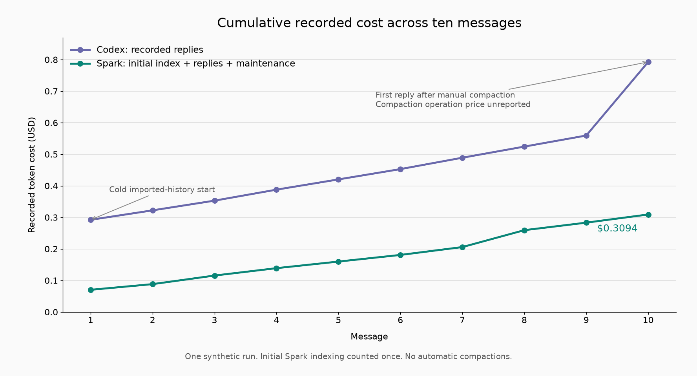

# Measurements

**Updated 10 October 2026.** Each result below comes from a different workload, with its own starting history, engine, cache conditions and tasks, so I list them separately instead of averaging them. Every dollar figure is an API-equivalent price calculated from recorded token counts ([how](caching-and-cost.md)).

## All results so far

| Workload | Recorded cost reduction | Timing result | Setup boundary |
|---|---:|---|---|
| Earlier 50-prompt memory trial | **83.8%** ongoing | **12.1% less** sequence time | Existing index; historical full-history comparison. |
| 1,166 originals, ten continuing recall prompts | **78.3%** ongoing; **54.9%** including historical index once | Reply sequence took 4.5% more time | Same custom engine in both arms. |
| Later ten-question recall comparison | **74.8%** ongoing; **52.1%** including historical index once | 8.8% more sequence time | Codex with full history; existing Spark index. |
| Five-question recall diagnostic | **78.8%** ongoing; **51.2%** including historical index once | 36.5% more active time | Previously used recall prompts; existing index. |
| Build a site, then redesign it, Astra High | **33.6%** for recorded new work | **26.9% less** engine-turn time | New helpers included; prior project setup not newly priced. |
| Ten-message long-history test: Spark 63/63, Codex 61/63 | **61.0%**, including a fresh index and maintenance | Mean reply: Spark **7.49 s**, Codex **5.31 s** | One manual Codex compaction; its token price unreported. |
| Latest paired Spark update: 63/63 before and after | **64.8%** against a separate earlier Codex reference | Spark mean reply improved **9.8%**, from **9.09 s** to **8.20 s** | Cold indexes and helpers included; Codex was not rerun concurrently. |

The 50-prompt trial is where my "up to 84%" and "about 12% faster" come from. It reused an index that cost $0.01595118 to build. Counting that once moves Spark's cost from $1.17940604 to $1.19535722, against $7.281696 for the full-history run: **83.58% lower**. The 112.98-second index build isn't included in the sequence time.

Importing the 1,166-message chat cost **$0.1345994** and took **440.26 seconds**, once. The later recall rows that include setup use that one import; it wasn't repeated for each new configuration.

The build-and-redesign pair recorded **$3.34404172 and 635.169 seconds** in Spark against **$5.037892 and 868.646 seconds** in Codex. Neither app compacted. The two apps took different tool routes and ended up with slightly different features, and nobody graded the results independently, so I count it as support for my daily experience and not as a clean test of the memory method.

[Historical aggregate records](../data/historical-observations.json)

## What I see in daily use

I keep each project in the same chat through many tasks, corrections and returns to earlier work. In that daily use I've seen savings of **70% and more**, and Spark often finishes a piece of work before Codex does. Those are my observations, not matched measurements, and they're the reason I'm building the tests below.

Daily work is not a quiz of short replies. A working session includes tools, lookups, preparation and context transitions. In the quiz-style test, Codex answered faster per reply. In the build-and-redesign pair, Spark spent less engine time. My next test times whole working sessions to find out where the difference comes from.

The phase breakdown further down shows that the biggest savings come when Codex has to process a large context from scratch: the first message on an imported history and the first reply after compaction. How often that happens in a normal week of Codex use is exactly what the resumption test will measure.

## Latest prototype update

This run compared my previous Spark build with the updated one on a fresh synthetic history: **32 messages and ten matched requests**, with independent cold indexes, alternating run order, and every helper call counted. The Codex column comes from the previous matched-workload trial with a different corpus salt. I didn't rerun Codex at the same time.

| Measurement | Previous Spark | Updated Spark | Codex, earlier reference |
|---|---:|---:|---:|
| Mean full-reply time | 9.09 s | **8.20 s** | 5.92 s |
| Recorded cost, index and helpers included | $0.2842473 | **$0.2851002** | $0.8100080 + unreported compaction cost |
| Required checks passed | **63/63** | **63/63** | **63/63** |
| Fully passing turns | 10/10 | 10/10 | 10/10 |
| Main-model calls | 15 | 14 | 10 |
| Initial indexing time | 58.14 s | 45.76 s | Not used |
| Measured lifecycle time | 151.02 s | 137.15 s | 99.24 s |

The update cut Spark's mean reply time by **9.83%** and its lifecycle time by **9.19%**, while cost rose by **0.30%**, less than a tenth of a cent across the run. Both builds kept every original intact, passed all 63 checks, and the new one needed 14 main-model calls instead of 15.

Against the earlier Codex reference, the updated Spark cost **64.80% less**, and its mean reply was **38.49% longer**. Codex also passed all 63 checks in that reference, and its compaction usage wasn't reported.

[Update counters and arithmetic](../data/spark-update-10-turns.json)

## The ten-message test

### What each side ran

Both sides started from **32 synthetic historical messages with 328,410 characters** and then received **the same ten long messages**, each about 16,500 to 17,100 characters.

The tasks mixed old exact-text recall, later corrections, unrelated material, separate projects, proposals versus approvals, and a small dependency-selection problem with an explicit tie-breaker. Both sides could read the same exact originals through read-only evidence tools, and both used the **same main model and reasoning setting**.

Spark ran the installed prototype's real archive, index, context building and evidence tools through my integration. Codex ran the official Codex app-server engine with the full imported history in its native context, plus one manual compaction before message ten. The engine builds and product instructions were different, so this compares two real apps, not one app with a single setting flipped.

Each side followed one native thread. Reply time runs from sending the request to the finished, saved reply, without desktop rendering.

### Cost

| Stage | Spark | Codex, official engine |
|---|---:|---:|
| Main-model inferences | $0.27697360 | $0.79289520 |
| Fresh initial indexing | $0.02061608 | Not used |
| New indexing and maintenance | $0.01178644 | Not used |
| **Total recorded cost** | **$0.30937612** | **$0.79289520** |
| Manual compaction | None | **Price unreported** |

```text
recorded saving = 1 - 0.30937612 / 0.79289520
                = 60.9815%
```

Spark's total includes the fresh import, every helper call, and every main-model round, retrieval included. Codex's total doesn't include its compaction, because the engine didn't report its usage, so the real gap is somewhat larger than 61%.

Importing the history is a one-time step for each chat. Here it cost about two cents and took **55.76 seconds**. Without the import, Spark's preparation took about **7 seconds** (62.78 s in total), the same as Codex's **6.91 seconds**.

### Where the saving came from

These rows split the same ten messages into phases. They aren't extra trials.

| Phase | Spark recorded cost | Codex recorded cost | Saving |
|---|---:|---:|---:|
| Message 1: cold imported history; Spark index included once | $0.07060344 | $0.29242040 | **75.86%** |
| Messages 2–9: ordinary continuation | $0.21284162 | $0.26720440 | **20.35%** |
| Message 10: first reply after manual Codex compaction | $0.02593106 | $0.23327040 | **88.88%** |
| **All ten messages** | **$0.30937612** | **$0.79289520** | **60.98%** |

Every Spark row includes its main and maintenance work, and the import is charged once, in the first row. The last Codex row is the reply after compaction; the compaction itself is still unpriced.

The first message and the post-compaction reply account for **88.76% of the dollar difference**. In Codex's first reply, 145,512 of its 153,576 input tokens were processed fresh. After compaction, 115,072 of 123,136 were. Both calls still had 8,064 cached tokens, so cache reuse was low but not zero.

On the warm middle turns Spark stayed cheaper, by about 20%, and the cumulative saving moved from **75.86% at message one to 49.35% at message nine**, then back up to 60.98% after message ten. So the saving doesn't grow with every message. It's biggest whenever Codex has to process the history from scratch.

That makes the practical question: how often does that happen during real work? Opening an existing project, coming back after the cache can no longer be reused, and continuing after compaction are the cases to measure, one by one, using the actual cached-token counts. [The resumption test](testing.md#project-resumption-and-context-transition-test)

### Cached input and call counts

| Metric | Spark main model | Spark Luna helpers | Codex main model |
|---|---:|---:|---:|
| Input tokens | 859,158 | 353,865 | 1,759,692 |
| Cached input tokens | 765,696 | 47,872 | 1,441,152 |
| Cached share of input | **89.12%** | 13.53% | **81.90%** |
| Reported cache-write tokens | 0 | 0 | 0 |
| Output tokens | 1,348 | 2,649 | 1,170 |
| Model inferences | 16 | 19: 9 initial, 10 maintenance | 10 |
| Recorded cost | $0.27697360 | **$0.03240252** | $0.79289520 |

Both main models are priced at **the same fresh-input, cached-input, cache-write and output rates**, and Codex's **1,441,152 cached tokens** are priced at the cheap cached rate in its total. Luna has its own, much lower rates. All of its work, including the import, cost **about 3.24 cents** and is counted in Spark's total. [Rates and formula](caching-and-cost.md)

Comparing like with like, Spark's main model got **89.12%** of its input from cache, against Codex's **81.90%**. If you mix in Luna's calls, Spark's overall cached share is **67.07%**, but that blends two models with different jobs and prices; each receipt is priced at its own model's rates.

The receipts reported zero cache-write tokens for this run. No tool results were replaced or shortened in this run either, so the whole saving comes from the archive and selective context.

### Spark's working context also grows

The bridge keeps the imported history out of the working context. The working thread itself still grows as the conversation continues.

| Main-model input at a measured call | Spark | Codex |
|---|---:|---:|
| First inference, message 1 | 16,917 tokens | 153,576 tokens |
| First inference, message 9 | 83,508 tokens | 210,169 tokens |
| First inference, message 10 | 90,826 tokens | 123,136 tokens, after manual compaction |

From message one to nine, Spark's input grew by about 8.3K tokens per message and Codex's by 7.1K. The test messages were long, and Spark made a few extra retrieval rounds. Spark started about 137K tokens lighter, so it had far more room left. This test peaked at 90,826 tokens and ended before Spark's first rebuild, which in the current build happens at about 126K. Measuring rebuilds and evidence redelivery over a long project is one of the next tests.

### Cost and time per message

Spark's per-message cost includes that message's main and maintenance work. The import is counted once, in the cumulative columns.

| Message | Spark new cost | Codex reply cost | Spark cumulative, index included | Codex cumulative, recorded | Spark reply | Codex reply |
|---|---:|---:|---:|---:|---:|---:|
| 1 | $0.04999 | $0.29242 | $0.07060 | $0.29242 | 10.83 s | 4.05 s |
| 2 | $0.01798 | $0.03004 | $0.08859 | $0.32246 | 4.69 s | 2.31 s |
| 3 | $0.02721 | $0.03074 | $0.11579 | $0.35320 | 7.21 s | 2.80 s |
| 4 | $0.02340 | $0.03485 | $0.13919 | $0.38805 | 12.47 s | 13.56 s |
| 5 | $0.02090 | $0.03248 | $0.16009 | $0.42053 | 3.41 s | 2.48 s |
| 6 | $0.02105 | $0.03265 | $0.18114 | $0.45318 | 3.52 s | 2.93 s |
| 7 | $0.02492 | $0.03608 | $0.20606 | $0.48926 | 10.85 s | 10.21 s |
| 8 | $0.05353 | $0.03525 | $0.25959 | $0.52451 | 11.11 s | 2.94 s |
| 9 | $0.02385 | $0.03511 | $0.28345 | $0.55962 | 4.83 s | 3.14 s |
| 10 | $0.02593 | $0.23327 | $0.30938 | $0.79290 | 6.00 s | 8.62 s |

Even on message one, with the import included, Spark cost **75.86% less** than Codex's first reply. Message eight is the one turn where Spark spent more than Codex, because it made several lookup rounds. Message ten is Codex's first reply after compaction.



*Spark includes the import and maintenance. Codex's compaction price is unreported. One measured sequence.*

[Per-message CSV](../data/long-history-turns.csv) · [Per-inference receipts](../data/long-history-10-turns.json)

### Time and compaction

| Timing | Spark | Codex |
|---|---:|---:|
| Mean full-reply time | 7.49 s | 5.31 s |
| Median full-reply time | 6.60 s | 3.04 s |
| Mean first-text time | 6.60 s | 4.54 s |
| Sum of ten full-reply times | 74.92 s | 53.06 s |
| Initial index time | 55.76 s | Not used |
| Manual compaction time | None | 28.84 s |

Neither side compacted automatically. Codex's one manual compaction before message ten took **28.84 seconds**, separate from the reply times, and anyone waiting on it waits that long.

Adding that wait, Codex's replies took **81.90 seconds** in total against Spark's **74.92**. Adding the measured setup, including Spark's one-time import, gives about **137.70 seconds** for Spark and **88.81** for Codex. Once the import is done, it doesn't come back.

So Spark answers each message a bit more slowly because of its extra lookups, Codex pauses when it compacts, and the import is a one-time wait. How often automatic compaction happens in everyday use is part of the working-session test.

An earlier recall run did report a compaction receipt: 198,812 fresh input tokens, 1,824 output tokens, **$0.415864**, and **55.03 seconds**. That gives an idea of what one compaction can cost, but it belongs to a different workload, so I don't add it to this run.

### Recall and correctness

Spark passed **63/63 checked fields** and **10/10 turns**. Codex passed **61/63 fields** and **8/10 turns**. Both recovered the old exact markers, the multilingual source text, the project distinctions and the approval states.

Codex's two misses were the same tie-breaker: it found a valid maximum-value, minimum-cost answer but picked the wrong one of two equally good ID orderings, and repeated it in the final state. In the later reference run it passed all 63, so I read this as both apps recalling the history correctly, with Spark doing it for much less.

The expected answers were written down separately from the model outputs, all 1,024 candidate subsets of the selection problem were enumerated, and the original records were checked after the run. The next step is grading by me on my own project, and replication by other people.

## What I'm testing next

The synthetic history used long, noisy messages to stress the context and exact recall, so a normal coding chat will have different economics. The two sides also ran different engine builds, and provider caching was outside my control.

Next comes long project work with the same tools and starting files, alternating which app goes first, recording every context transition, and scoring the finished work independently. I'll report early-message cost, reuse of an existing index, the one-time import, time to first text, full completion, and every interruption separately. [The test plan](testing.md)
