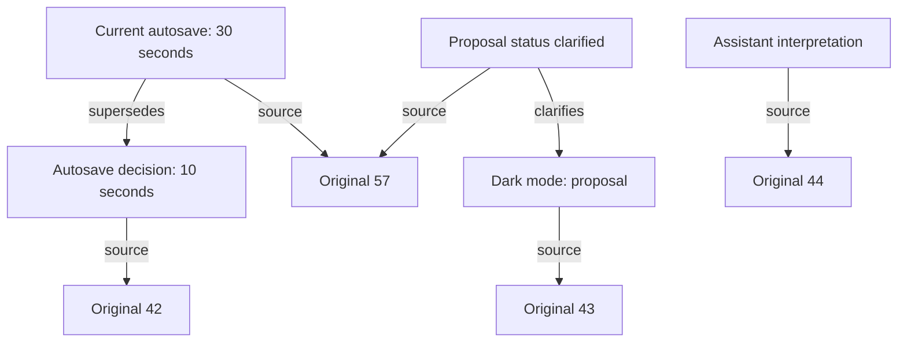

# How the context bridge works

A long project builds up decisions, corrections, files, tool results and unfinished plans. The usual way to keep an assistant on track is to send the whole growing conversation with every request, and when that gets too big, squeeze it into a summary. Sending everything gets expensive. A summary loses the exact words, and sometimes you need them: to quote an instruction, settle a disagreement, or tell a proposal apart from an approval.

The context bridge keeps the full history outside the model and sends it only what the current task needs, with a way back to every original. I built it into Spark, my own workspace client that runs on Codex model sessions. In a ten-message test it cost 61% less than Codex and got every check right ([measurements](measurements.md)).

## 1. What I wanted

I wanted the assistant to keep track of a project the way a good colleague would: what I meant, what it understood, what it changed, what I accepted, and what I corrected later.

Different moments need different things. One task needs an old sentence word for word. Another only needs the current plan. A third needs to know that two similar chats belong to different projects. Sending the whole history every time spends money on material the next step doesn't use. So the history stays complete, the working context stays small, and the assistant can always say where its understanding came from and reopen the evidence.

## 2. Three layers with different lifetimes

| Layer | How long it lives | What it's for |
|---|---|---|
| Original archive (A) | Forever, across tasks and model sessions | Exact evidence |
| Understanding and map (B) | Forever, updated as the work changes | Meaning and connections |
| Working context | One model session | What the model reads right now |

The provider's prompt cache sits underneath all three. Spark benefits from it like any other client, but it doesn't control it.

The prototype stores everything in SQLite on my PC. Any store works, as long as an addressed original can be read back exactly, independent of how it was interpreted.

## 3. A: exact originals with stable addresses

Every message gets an address:

```text
/c/example-chat/42
   chat / message number
```

The number only locates the message. It says nothing about relevance or size.

Once a message is stored, nothing changes it under that address. A correction is a new message that points back to the old one, never an edit of my earlier words.

Long messages are read in pages. The agent gets an exact range with its address, its position and where the rest continues, so a 50,000-word paste is stored whole and read as needed. A page is always marked as a page, so the agent never treats the first part of a message as all of it.

Hashes catch accidental changes between what was stored and what was returned.

## 4. B: the current understanding

A holds my messages. It also keeps the assistant's messages and tool results, each labeled with who or what produced it. An assistant's statement about approval stays an assistant statement. A tool's success result can show that an operation finished, but it can't stand in for my permission.

B holds the project goal, the active task, the rules, the decisions and corrections, what was tried, what was rejected, what's done, what's next, and what's still open. Every item that matters links to its source. When something is uncertain, B marks it as uncertain.

Interpretation is useful, and it can be wrong: a paraphrase can drop a condition, a project name can be ambiguous, a suggestion can look like an instruction. Keeping the originals means every interpretation can be checked and fixed. The memory tools can read originals and update B, but they can't grant themselves permission by rewriting it.

### Who writes what

Two kinds of interpretation sit on top of A, and they're written by different models:

- **The index, written by Luna.** For each message Luna records claims: a topic or key, the interpreted value, its status, the exact supporting quote, the source ID, and a link to whatever the claim replaces.
- **The B notes, written by the main agent** through a dedicated tool as it works: its working understanding, notes on outcomes and evidence, open questions, and exact source references.

When the agent reads B, Spark shows the notes together with the most recent indexed claims, so the two can look like one thing. Both are fallible interpretations, and my original messages stay the authority.

### Keeping B small as the project grows

B is a working view, not a second transcript. By default it carries the current goal, the active rules, the accepted decisions, the open questions, recent verified results and the next steps. Finished episodes and replaced interpretations move out of the default view but stay stored and linked to their originals, so the agent can reopen them by topic, by decision chain, by date or by search.

### When an interpretation misses something

Luna can miss a rule when it indexes a message, and the agent can leave something out of its B notes. Source links let you check what B contains, but they can't show what B left out. So the archive should also record which messages were interpreted, which were skipped or failed, and which need another pass. The agent can always reach originals outside B through search and chronological browsing, which matters most for a new instruction that hasn't been interpreted yet. The [hidden-rule test](testing.md#hidden-rules-without-reminders) checks whether earlier rules actually shape later work.

## 5. Corrections and proposals

Take these fictional messages:

| Address | Speaker | Original |
|---|---|---|
| `/c/demo/42` | Human | "Use autosave every 10 seconds. Keep it local." |
| `/c/demo/43` | Human | "Maybe add dark mode later." |
| `/c/demo/44` | Assistant | "I will add dark mode with autosave." |
| `/c/demo/57` | Human | "Change autosave to 30 seconds. Dark mode was only an idea." |

The bridge links the correction to the original interval and the clarification to the proposal. The assistant's message 44 stays recorded as the assistant's own interpretation and never counts as approval.



The next request carries the current interval and the proposal's status, with routes back to the earlier messages. If I ask why the decision changed, the agent can follow the chain instead of inventing a story around the latest value.

## 6. Rules I don't repeat

At message 50 I write "Never use Library X in this project." At message 180 I ask for a date picker without mentioning it. B holds the rule as an active project constraint with message 50 as its source. The request includes the project's active rules next to the new task, so the agent sees the rule and can open my original words before it chooses a dependency. I never have to say "remember message 50."

This works when the rule made it into B, under the right project. The archive is the backup route if it didn't, and the hidden-rule test measures how often the agent gets it right. The [runnable example](reference-example.md) shows the storage, scope and source rules with hand-written B records.

## 7. The index and the map

The source directory finds originals by address and by date. Topic and decision records find them by meaning. Project and chat boundaries keep each search inside the right work.

The map connects projects to chats, chats to topics, and topics to decisions, corrections, results and source addresses. It shows both interpreted messages and messages whose interpretation is incomplete or uncertain.

Each route has its job. An address gives a direct lookup: if the agent knows the chat and message ID, it fetches the exact original, with no guessing or ranking. Search finds candidates when you know the words. It's SQLite full-text keyword search ranked by BM25, with no embeddings or vector database, and it runs over the indexed text of the originals, normally inside the current chat; a project search can include the project's other chats. Topic links surface related evidence when I refer to an earlier idea indirectly, and the agent can also open the messages around a source to see its context.

A keyword search that finds nothing doesn't prove something never happened, so the agent can still browse topics, fetch originals by ID and read neighboring messages. A topic label is never the only way to reach an original, so one interpretation mistake can't hide intact evidence.

## 8. Import once, then keep it updated

Importing an existing chat does two things: it stores the originals, and it builds the navigation records. Luna, a smaller and much cheaper helper model, reads the material in batches and links new records to earlier sources. The main model does the actual work. In the test, the whole import cost about 2 cents and took 56 seconds.

From then on, new messages and results extend the archive and update only the records they affect. A correction updates the current understanding and adds a link to the earlier evidence. Questions that only read history don't need new indexing at all.

Indexing can run in the background, with one rule: if an answer depends on a correction that hasn't been indexed yet, the bridge shows the agent that original or waits for the update. Background work never gets treated as finished when it isn't.

## 9. Building a request

A request contains my new message, the active work state, the relevant parts of B with their sources, selected original messages, recent interactions, and addresses for everything else.

For the autosave example, the map finds the 10-second request and the 30-second correction, B says the current interval is 30 seconds and the implementation is unfinished, and the agent can open both originals before it changes anything. The finished change then becomes evidence for the next task.

The request has a budget. When everything relevant doesn't fit, it carries the most useful part plus addresses and continuation points for the rest. Leaving something out of one request never deletes it from the archive. The budget counts the whole request, including instructions, tools and earlier session turns, not just the evidence.

The agent can open several known sources at once, read an exact range, expand a topic, or search. Each extra round costs time and tokens, which is why Spark is sometimes slower per reply. The goal is enough evidence for the task, available before an answer counts as grounded.

## 10. Knowing what the session has already seen

The bridge records which source passages reached which model session, so it doesn't send the same evidence twice while the session still has it. It only marks a passage as delivered after the request went through, and a partial page counts as partial.

When the model session changes, that record starts fresh for the new session. The archive is unchanged, but the new session may need some evidence again.

Spark continues native model threads, so recent turns accumulate. In the ten-message test, Spark's first request was 16,917 tokens against Codex's 153,576, and by message ten Spark's had grown to 90,826. The bridge keeps the imported history out of the working context. Keeping the working context small over many sessions is the job of the rebuild in section 12. The test peaked at 90,826 tokens and didn't reach a rebuild. ([Spark's working context also grows](measurements.md#sparks-working-context-also-grows))

## 11. Files, commands and tool results

Project work produces more than chat: file reads, command output, browser observations and finished artifacts. These are evidence of what actually happened, and their source and scope matter as much as the wording of an instruction.

I think of the tool side as a call center: one route for evidence and operations, with the main agent deciding what each task needs. Independent reads run together in a batch, and dependent ones run in order. Batching works in the prototype today. A general dependency planner is still experimental.

## 12. When the working context fills up

The archive lives outside the model's context window, so the project's history never depends on one rolling summary. When a working session gets close to its budget, Spark starts a fresh one, rebuilding the context from the current work state and the addressed evidence. The index stays as it is.

The visible chat stays the same chat through a rebuild. Its addresses, decision links and recorded work are all still there. Starting a new internal model session is very different from asking me to open a new chat and explain the project again.

In the current build, the working context has a budget of 150K tokens, capped at 60% of the model's context window. Spark rebuilds before a request would go over it: when the last request's input, plus the new message, plus a 24K safety reserve would pass 150K. With a short new message, that happens at about 126K tokens. The count is a conservative estimate, not exact token counting, and a rebuild never touches the archive.

A rebuild doesn't ask any model to summarize the old session. Spark starts a fresh thread and assembles a new context from what it already keeps:

- the usual instructions, tools and runtime settings
- my current message, exactly as written
- selected exact excerpts from the history, the indexed claims and their status, and the checks that require certain sources to be opened
- navigation IDs, the existing B notes, and relevant excerpts from other chats when they're selected
- up to three recent assistant replies, word for word. Each must fit in 4KB, and a longer reply is replaced by a pointer to its ID. If adding them would push the packet over 64KB, they're left out.

The B notes and indexed claims are interpretations, so they're summary-like, but the rebuild carries them over instead of writing them, and Spark never treats them as original evidence. The only new things written during a rebuild are bookkeeping: the new thread ID, its generation number, the delivery checkpoint and the logs. Anything the new session doesn't receive, including old tool results, can still be opened by its ID.

A rebuild still takes work, and the window is still finite, so a production version needs a clear policy for what stays in the session, what gets reopened, and when to start fresh.

Compaction is the other common approach. OpenAI's API compaction can return an opaque, encrypted item along with retained context ([documentation](https://developers.openai.com/api/docs/guides/compaction)), so you can't read it the way you'd read a summary. The difference I care about is the explicit route from the current understanding back to exact evidence. The bridge can also work alongside compaction.

## 13. Related work

External memory for language models has a long research history. [Retrieval-Augmented Generation (Lewis et al., 2020)](https://arxiv.org/abs/2005.11401) combines generation with retrieved knowledge. [ReAct (Yao et al., 2022)](https://arxiv.org/abs/2210.03629) interleaves reasoning with actions such as looking things up. [MemGPT (Packer et al., 2023)](https://arxiv.org/abs/2310.08560) manages information across memory tiers for agents.

The context bridge applies those ideas to long project work. The parts I added are the A/B split (originals keep their speaker, and only my words can approve), stable addresses for chat history, correction and decision links, project-scoped navigation, incremental indexing, and tracking what each session has already seen. I haven't run head-to-head comparisons against those systems.

## 14. Results and next steps

So far the measurements show that selective context backed by exact originals costs much less and still recovers the details that matter, and that indexing an existing chat is cheap compared with sending its whole history again and again. The biggest savings come when Codex has to process a large context from scratch. Spark is slower per reply today because of its extra lookups. [All measurements](measurements.md)

Next I want to compare sustained work: the same starting files, model, tools and requests, with real coding, changed requirements, several projects and natural context limits. That means counting setup once, every helper and main call, every compaction, retry and wait, and having the work scored independently. [The test plan](testing.md)

I'm publishing the method because it has made my own long projects cheaper and easier to keep straight. The parts I most want other people to test are finding the right evidence, keeping my current intent, and finishing the work with less context.
