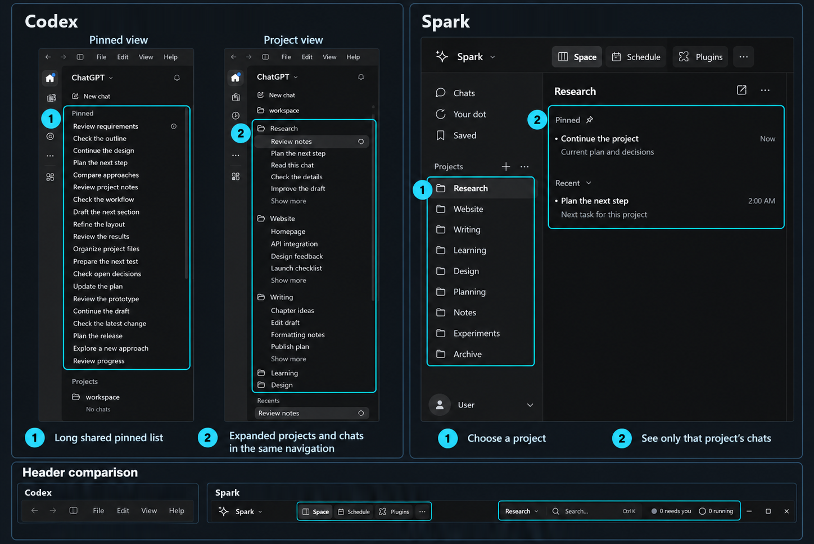

# Spark: where the idea started

Spark started as a workspace client for my own projects. I wanted projects to be easier to find and their conversations to stay organized inside them. The memory method came later, from using it every day.

## Two sidebars

*Screenshots edited with fictional names. The two Codex views are the same sidebar at two scroll positions. Spark shows its two sidebars side by side. The numbers point to navigation and the header; this picture isn't about performance.*

| Area | Codex layout shown | Spark prototype |
|---|---|---|
| Pinned work | A long shared pinned list sits above the projects. | Pinned chats stay inside the selected project's chat sidebar. |
| Project navigation | Expanded projects and their nested chats share the same navigation column. | The project list stays in the first sidebar; selecting one scopes the second sidebar to its chats. |
| Top menu/header | The window shown uses the traditional File, Edit, View, and Help menu. | Workspace controls, project selection, search, running work, and work needing attention share the top bar. |

With many projects, I kept scrolling through one long pinned list and expanded project chats in the same column. In Spark, the first sidebar holds my projects in the order I want. The second shows only the selected project's chats, pinned and recent. I pick a project, then see its work.

The conversation sits in the middle, and files and other workspace material can sit in a panel beside it. The styling still looks a bit dated to me, but the organization is what I wanted: less searching, pinned work staying with its project, and a header that tells me where to act. It's how I like to work, and other people may prefer something else.

## A header I actually use

I almost never used the File, Edit, View and Help menu in my Codex window, so in Spark the top bar does something useful. It shows the selected project, search, workspace controls, chats that are **running**, and chats that **need me**. "Now" in the chat list marks recent activity. If an agent is working in another chat or waiting for my decision, I can see it without opening every chat.

## From organizing projects to organizing context

Once my projects were easy to navigate, I started asking why the model needed so much of the old conversation to continue them. Spark already stored every original message. Could the agent move through that history the way I move through the workspace: follow the structure first, then open the exact detail when it needs it?

That became the context bridge: a route from the current request and the current understanding to the relevant history, with links that keep decisions, corrections and finished work connected.

## How Spark connects

Spark talks to Codex model sessions through my own local integration. A smaller helper model does the indexing and interpretation, and the main model does the actual task.

Spark doesn't do everything Codex does yet. The one I miss most is image generation: the Codex integration I used doesn't expose it, so Spark doesn't cover that part of my work yet. (OpenAI does offer image generation through its [API](https://developers.openai.com/api/docs/guides/image-generation), so this is a gap in my prototype.)

The archive stays on my PC, but the context selected for each request is sent to the model service, as with any cloud model.

## Trying Spark

I'm sharing the method and the results now, and I'm still deciding how to share the app itself. This repository has no app code, installer, engine binary, private chats or account details.

If you'd like to review the design or try Spark when it's available, [open an issue](https://github.com/abdulrhmansayed/sparks-context-bridge/issues) and tell me what kind of project you'd use it for. [The test plan](testing.md) lists the comparisons I'd most like to see.
